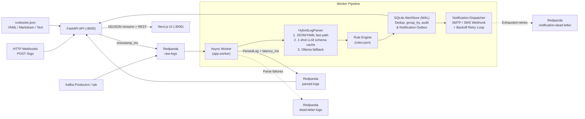

# GSP — Schema-Agnostic Alerting & Incident Resolution Platform

GSP is a real-time event ingestion, alerting, and incident resolution platform built with **Redpanda (Kafka)**, **FastAPI (`aiokafka`)**, **Ollama**, **SQLite (WAL)**, and **Next.js**.

It accepts arbitrary payloads over HTTP or Kafka (JSON, YAML, or unstructured text—including previously unseen schemas), normalizes them through a hybrid heuristic/LLM parser, evaluates hot-reloaded JSON Pointer rules with deduplication and grouping, delivers notifications through a durable retry outbox with working-hours awareness, attaches context-interpolated runbooks with approval-gated steps, and streams everything live to a web UI.

---

## Core Capabilities

- **Schema-agnostic ingestion**: Send any JSON, YAML, or plain-text event to `POST /logs` or directly to the `raw-logs` Kafka topic without pre-registering schemas.
- **Hybrid parsing pipeline**: Structured JSON/YAML takes a fast deterministic path; unfamiliar nested JSON triggers a one-time LLM schema-mapping inference cached by structural fingerprint; unstructured text falls back to local Ollama (`qwen2.5:1.5b`).
- **Declarative rule engine**: Evaluate JSON Pointer expressions (`/path/to/field`) with `all`/`any`/`not` logic, hot-reloaded from `rules.json` with zero restarts and dry-run testing via `POST /rules/evaluate`.
- **Alert deduplication & lifecycle**: Transactional SQLite (WAL) store with per-rule `group_by` fingerprints, configurable `dedup_window_seconds`, `open → acked → resolved → reopen` transitions, and full audit history.
- **Durable notification outbox**: Working-hours-aware Email (SMTP) and SMS (webhook) routing with exponential-backoff retries and a `notification-dead-letter` Kafka topic for exhausted deliveries.
- **Runbooks & AI fix proposals**: Attach YAML, Markdown, or plain-text runbooks with `{{placeholder}}` interpolation and `approval: required` step gating, plus on-demand `Propose Fix` suggestions for runbook or rule improvements.
- **Live Observatory UI**: Next.js interface for watching live NDJSON log streams, triaging deduplicated alerts, executing runbook steps, and editing rules and runbooks.

---

## Architecture



### Repository Layout

```text
.
├── app/
│   ├── main.py            # FastAPI routes (ingestion, streams, rules, alerts, runbooks, outbox)
│   ├── worker.py          # Async Kafka consumer, batch processor, and outbox retry loop
│   ├── parser.py          # Hybrid JSON/YAML fast parser, schema-learning cache, Ollama fallback
│   ├── rules.py           # JSON Pointer rule evaluator, hot-reload cache, routing
│   ├── alerts.py          # SQLite (WAL) alert store, deduplication, audit trail, outbox table
│   ├── notifications.py   # Working-hours window check, SMTP/SMS dispatch, outbox retries & DLQ
│   ├── runbooks.py        # Template interpolation, YAML/MD/text parsing, approval-gated execution
│   ├── proposals.py       # LLM + heuristic fix proposals for runbooks and rules
│   ├── kafka_client.py    # aiokafka producer/consumer wrapper
│   ├── ollama_client.py   # Async Ollama HTTP client
│   ├── schemas.py         # Pydantic models
│   └── config.py          # Environment-backed settings
├── frontend/              # Next.js 16 + React 19 + Tailwind CSS Observatory UI
├── scripts/
│   ├── loadtest.py        # Stdlib-only throughput & latency benchmark
│   └── simulate_http_logs.py  # Continuous sample traffic generator
├── tests/                 # Pytest unit & integration test suite
├── rules.json             # Default alerting rules (mounted into Docker)
├── runbooks.json          # Default remediation runbooks (mounted into Docker)
└── docker-compose.yml     # Full local stack (Redpanda, Ollama, API, Worker, UI)
```

---

## Quickstart

### Prerequisites

- Docker with Docker Compose (`docker compose`)

### 1. Start the Stack

```bash
docker compose up -d --build
```

If ports `8000`, `3000`, or `19092` are already bound on your host, override them inline:

```bash
API_PORT=8088 UI_PORT=3001 KAFKA_EXTERNAL_PORT=29092 docker compose up -d --build
```

> **First startup note:** The one-shot `ollama-init` container pulls `qwen2.5:1.5b` (~1 GB) into the persistent `ollama_data` volume. Subsequent startups reuse the cached model.

| Service | Address | Role |
| --- | --- | --- |
| **Next.js UI** | `http://localhost:3000` | Live log feed, deduplicated alerts, rulebook & runbook editors |
| **FastAPI API** | `http://localhost:8000` | HTTP ingestion, live NDJSON streams, rules, alerts, runbooks, outbox |
| **Redpanda** | `localhost:19092` (host) / `redpanda:9092` (Docker) | Kafka-compatible broker (`raw-logs`, `parsed-logs`, DLQ topics) |
| **Ollama** | `http://ollama:11434` (internal) | Local LLM for unstructured parsing, schema learning, and fix proposals |
| **Worker** | `python -m app.worker` | Consumes `raw-logs`, parses, evaluates rules, deduplicates, dispatches |

### 2. Send Sample Events

**High-latency error** (matches the default `high-latency-error` rule and attaches the YAML checkout runbook):

```bash
curl -X POST http://localhost:8000/logs \
  -H "Content-Type: application/json" \
  -d '{
    "timestamp": "2026-10-23T09:14:02.331Z",
    "level": "ERROR",
    "service": "checkout-api",
    "message": "payment gateway timeout",
    "order_id": "ord_98421",
    "latency_ms": 5021
  }'
```

**Unseen workflow failure schema (HTTP):**

```bash
curl -X POST http://localhost:8000/logs \
  -H "Content-Type: application/json" \
  -d '{
    "type": "WORKFLOW_FAILED",
    "workflowId": "WF-20261023-00042",
    "workflowName": "order-settlement",
    "step": "validate-counterparty",
    "severity": "ERROR",
    "environment": "prod",
    "timestamp": "2026-10-23T09:14:02.331Z",
    "error": {"code": "TIMEOUT", "message": "Counterparty service did not respond in 5000 ms"}
  }'
```

**Alertmanager-style webhook (HTTP):**

```bash
curl -X POST http://localhost:8000/logs \
  -H "Content-Type: application/json" \
  -d '{
    "alertname": "HighErrorRate",
    "labels": {"service": "payments-api", "region": "eu-west", "severity": "critical"},
    "annotations": {"summary": "Error rate 12% over the last 5 minutes"},
    "startsAt": "2026-10-23T09:13:00Z",
    "status": "firing"
  }'
```

**Nested business event (directly via Kafka):**

```bash
echo '{"meta":{"schema":"trade.rejected.v2","producer":"trade-gateway","ts":1792833245000},"payload":{"tradeId":"T-998877","desk":"rates","notional":25000000,"currency":"EUR","reason":"LIMIT_BREACH"}}' \
  | docker compose exec -T redpanda rpk topic produce raw-logs
```

### 3. Inspect Alerts & Runbooks

- Open **`http://localhost:3000`** to watch the live parsed stream, inspect deduplicated alerts, execute or approve runbook steps, transition alert status, or click **Propose Fix**.
- Or query the API:

```bash
curl -s http://localhost:8000/alerts | python3 -m json.tool
```

---

## Real vs. Simulated Components

| Component | Status | Notes |
| --- | --- | --- |
| **HTTP & Kafka ingestion** | Real | Redpanda broker + `aiokafka` producer/consumer with manual offset commits. |
| **Hybrid schema-agnostic parser** | Real | Fast JSON/YAML heuristics, 1-shot LLM schema-mapping LRU cache, and Ollama fallback for unstructured text. |
| **Rule engine & hot reload** | Real | JSON Pointer evaluation (`eq`, `ne`, `gt`, `gte`, `lt`, `lte`, `in`, `not_in`, `contains`, `regex`, `exists`) with `all`/`any`/`not` trees and mtime-cached reloads. |
| **Deduplication, lifecycle & audit** | Real | SQLite WAL with `BEGIN IMMEDIATE` transactions, `group_by` fingerprints, `dedup_window_seconds`, and full status/step audit trail. |
| **Durable outbox & DLQ** | Real | Failed deliveries persist to `notification_outbox`, retry with exponential backoff, and dead-letter to `notification-dead-letter` after `NOTIFICATION_MAX_ATTEMPTS`. |
| **Email & SMS delivery** | Optional real / simulated by default | Sends real SMTP emails when `SMTP_HOST` is set and real HTTP POSTs when `SMS_WEBHOOK_URL` is set; otherwise records deliveries as `routed` and logs them. |
| **Runbook action execution** | Simulated handlers, real gating | Approval enforcement (`approval: required` returns HTTP `403` unless `approved: true`) and audit logging are real; built-in action handlers (`http_get`, `retry_workflow`, `restart_service`, `failover_region`, `escalate`, `open_ticket`, `webhook`) in `app/runbooks.py` return simulated outputs. |
| **Fix proposals** | Real (LLM + fallback) | `POST /alerts/{id}/propose-fix` queries Ollama within `PROPOSAL_LLM_TIMEOUT_SECONDS` and falls back to deterministic runbook/rule patches. |

---

## Key Concepts

### Hybrid Schema-Agnostic Parsing

Every raw message flows through `HybridLogParser`:

1. **Fast path (`ENABLE_FAST_PARSER=true`)**: Valid JSON or YAML is parsed without invoking the LLM, extracting canonical fields (`timestamp`, `level`, `service`, `message`, `metadata`) via deterministic heuristics.
2. **1-shot schema learning (`ENABLE_SCHEMA_LEARNING=true`)**: When an unfamiliar nested JSON shape arrives, Ollama infers a field-mapping once and caches it in an LRU cache keyed by structural fingerprint.
3. **Unstructured fallback**: Plain-text logs are parsed by Ollama (`qwen2.5:1.5b`).
4. **Original field preservation**: All original fields remain addressable in rules at both top-level JSON Pointers (e.g., `/payload/notional`) and `/event/...` (e.g., `/event/meta/schema`).

### Runbooks vs. Propose Fix

| | Runbooks (`runbooks.json`) | Propose Fix (`POST /alerts/{id}/propose-fix`) |
| --- | --- | --- |
| **Goal** | Resolve the **active incident now** | Improve **future alerting or remediation** |
| **Trigger** | Auto-attached when an alert matches `rule_ids` or `services` | Triggered on demand per alert (UI or API) |
| **Output** | Interpolated steps (`{{service}}`, `{{metadata.*}}`) with **Run** / **Approve & Run** controls | Draft YAML runbook (incorporating executed steps) or a rule patch (e.g., raising `dedup_window_seconds` on noisy alerts) |
| **Side effects** | Runs step handler and records an audit event on the alert | Read-only draft until an operator reviews and saves it |

---

## Extending GSP

### Add a New Event Source (Zero Code)

Publish any JSON, YAML, or text payload to `POST /logs` or the `raw-logs` Kafka topic. No schema registration or restart is required.

### Add or Edit a Rule (No Restart)

Edit rules in the **Rulebook** tab of the UI or replace `rules.json` via `PUT /rules` (hot-reloaded automatically by the worker):

```json
{
  "id": "rates-large-rejection",
  "name": "Large Rates Trade Rejected",
  "severity": "high",
  "enabled": true,
  "dedup_window_seconds": 300,
  "group_by": ["/payload/desk", "/payload/reason"],
  "notify": [
    { "channel": "email", "to": "rates-desk@example.com" },
    { "channel": "sms", "to": "+15550001234", "working_hours_only": true }
  ],
  "all": [
    { "field": "/meta/schema", "operator": "regex", "value": "^trade\\.rejected\\." },
    { "field": "/payload/desk", "operator": "eq", "value": "rates" },
    { "field": "/payload/notional", "operator": "gt", "value": 10000000 }
  ]
}
```

Dry-run any candidate rule against a sample event before saving with `POST /rules/evaluate`.

### Add a Runbook (No Restart)

Use the **Runbooks** tab or `POST /runbooks` (`format`: `yaml`, `markdown`, or `text`):

```bash
curl -X POST http://localhost:8000/runbooks \
  -H "Content-Type: application/json" \
  -d '{
    "id": "rb-payments-md",
    "name": "Payments High Error Rate",
    "format": "markdown",
    "rule_ids": ["high-latency-error"],
    "services": ["payments-api"],
    "description": "Markdown playbook for payments-api errors.",
    "content": "# HighErrorRate on {{service}}\n1. Check if errors are isolated to one region.\n2. Fail traffic over to the secondary region (needs approval).\n3. Roll back the latest deployment if all regions are affected."
  }'
```

### Add a Notification Channel or Runbook Action (Code)

- **Notification channel**: Add the channel literal to `NotificationChannel` in `app/schemas.py`, then add it to `_VALID_CHANNELS` and implement a delivery branch in `dispatch_notifications()` in `app/notifications.py`.
- **Runbook action**: Register a handler in `ACTION_EXECUTORS` in `app/runbooks.py`.

---

## API Reference

### Health & Logs

| Method | Endpoint | Description |
| --- | --- | --- |
| `GET` | `/health` | Health check (`ok`) |
| `POST` | `/logs` | Ingest raw event into Redpanda (`?topic=raw-logs`) |
| `GET` | `/logs` | Read raw logs (`topic`, `limit`, `from_beginning`, `timeout_ms`) |
| `GET` | `/logs/stream` | Live raw log stream (`text/plain`) |
| `GET` | `/logs/parsed` | Read parsed logs as a JSON array (`topic`, `limit`, `from_beginning`, `timeout_ms`) |
| `GET` | `/logs/parsed/stream` | Live parsed log stream (`application/x-ndjson`) |
| `GET` | `/logs/dead-letter` | Read failed parse events from `dead-letter-logs` |

### Rules

| Method | Endpoint | Description |
| --- | --- | --- |
| `GET` | `/rules` | Read the active rulebook (`rules.json`) |
| `PUT` | `/rules` | Validate and replace the rulebook (`rules.json`) |
| `GET` | `/rules/working-hours` | Inspect configured working-hours window and active status |
| `POST` | `/rules/evaluate` | Dry-run rules against a sample `message` (optional `at` timestamp and `rules` override) |

### Alerts & Incident Resolution

| Method | Endpoint | Description |
| --- | --- | --- |
| `GET` | `/alerts` | List deduplicated alerts with resolved runbooks (`status`, `service`, `rule_id`, `limit`) |
| `GET` | `/alerts/{alert_id}` | Fetch a single alert with audit history and resolved runbook |
| `POST` | `/alerts/{alert_id}/ack` | Acknowledge an alert (`actor`, optional `note`) |
| `POST` | `/alerts/{alert_id}/resolve` | Resolve an alert (`actor`, optional `note`) |
| `POST` | `/alerts/{alert_id}/reopen` | Reopen a resolved/acked alert (`actor`, optional `note`) |
| `POST` | `/alerts/{alert_id}/steps/{step_index}/execute` | Execute a runbook step (`actor`, `approved`, optional `note`; returns `403` if approval required) |
| `POST` | `/alerts/{alert_id}/propose-fix` | Generate an LLM/heuristic runbook or rule proposal (`target_type`: `auto` \| `runbook` \| `rule`) |

### Runbooks & Notification Outbox

| Method | Endpoint | Description |
| --- | --- | --- |
| `GET` | `/runbooks` | List all runbooks (`runbooks.json`) |
| `POST` | `/runbooks` | Create a runbook (`409` if `id` exists) |
| `PUT` | `/runbooks/{runbook_id}` | Create or update a runbook by ID |
| `DELETE` | `/runbooks/{runbook_id}` | Delete a runbook by ID |
| `GET` | `/notifications/outbox` | List notification outbox records (`status`, `alert_id`, `limit`) |
| `POST` | `/notifications/outbox/process` | Manually trigger one outbox retry pass |
| `POST` | `/notifications/outbox/{outbox_id}/retry` | Requeue a dead-lettered outbox item for immediate retry |

---

## Configuration

All settings are loaded via `app/config.py` (see `.env.example` for Docker Compose defaults):

| Variable | Default | Description |
| --- | --- | --- |
| `KAFKA_BOOTSTRAP_SERVERS` | `redpanda:9092` | Kafka/Redpanda broker address |
| `DEFAULT_TOPIC` / `PARSED_TOPIC` / `DEAD_LETTER_TOPIC` | `raw-logs` / `parsed-logs` / `dead-letter-logs` | Core Kafka topics |
| `NOTIFICATION_DEAD_LETTER_TOPIC` | `notification-dead-letter` | Topic for exhausted notification deliveries |
| `OLLAMA_BASE_URL` / `OLLAMA_MODEL` | `http://ollama:11434` / `qwen2.5:1.5b` | Local Ollama endpoint and model |
| `OLLAMA_TIMEOUT_SECONDS` | `60.0` | Timeout for LLM log parsing calls |
| `PROPOSAL_LLM_TIMEOUT_SECONDS` | `3.5` | Timeout before `propose-fix` falls back to heuristics |
| `WORKER_BATCH_SIZE` / `WORKER_CONCURRENCY` | `100` / `16` | Max records polled per batch and concurrent tasks |
| `ENABLE_FAST_PARSER` | `true` | Bypass LLM for structured JSON/YAML |
| `ENABLE_SCHEMA_LEARNING` | `true` | Enable 1-shot LLM schema-mapping cache |
| `RULES_FILE` / `RUNBOOKS_FILE` / `ALERTS_DB_PATH` | `rules.json` / `runbooks.json` / `data/alerts.db` | Local config and SQLite database paths |
| `WORKING_HOURS_START` / `END` / `DAYS` / `TIMEZONE` | `09:00` / `17:00` / `0,1,2,3,4` / `UTC` | Default working-hours notification window (`0`=Mon .. `6`=Sun) |
| `SMTP_HOST` / `SMTP_PORT` / `SMTP_FROM` | unset / `587` / `alerts@gsp.local` | Enable real SMTP email delivery |
| `SMS_WEBHOOK_URL` | unset | Enable real SMS webhook delivery |
| `NOTIFICATION_MAX_ATTEMPTS` | `5` | Max delivery attempts before dead-lettering |

---

## Benchmarking & Traffic Simulation

`scripts/loadtest.py` uses only the Python 3 standard library and reports throughput plus latency percentiles (`min`, `p50`, `p95`, `p99`, `max`) across three stages:

1. **HTTP Ingest** (`POST /logs`)
2. **Client End-to-End** (`POST /logs` → arrival on `/logs/parsed/stream`)
3. **Server Pipeline** (`ingested_at` at Kafka ingest → `processed_at` after parse, rules, and dispatch)

```bash
python3 scripts/loadtest.py \
  --url http://localhost:8000 \
  --count 500 \
  --concurrency 20 \
  --mix mixed \
  --json-out bench_results.json
```

Useful flags: `--mix {mixed,alerts,appendix,info}`, `--warmup 10`, `--drain-timeout 30`, `--skip-stream`.

To generate continuous demo traffic:

```bash
python3 scripts/simulate_http_logs.py --url http://localhost:8000 --interval 1.0
```

---

## Local Development & Testing

### Backend & Tests

```bash
pip install -r requirements.txt
pytest -v
```

### Frontend (Next.js)

```bash
cd frontend
npm install
API_BASE_URL=http://localhost:8000 npm run dev
```
