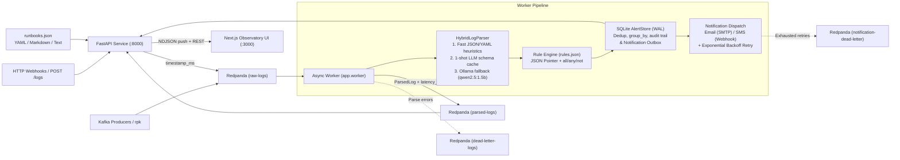

# GSP — Schema-Agnostic Alerting & Incident Resolution Platform

Real-time event ingestion, alerting, and runbook platform powered by **Redpanda (Kafka)**, **FastAPI (`aiokafka`)**, **Ollama**, **SQLite (WAL)**, and **Next.js**.

GSP ingests arbitrary events over **HTTP** or **Kafka** (JSON, YAML, or unstructured text—including unseen schemas), evaluates declarative JSON-Pointer rules with deduplication and grouping, dispatches notifications with working-hours awareness and durable outbox retries, attaches interpolated runbooks, and streams updates live to a web UI.

---

## Architecture



---

## Quickstart (Fresh Clone → Live Alert)

### 1. Start the stack

```bash
docker compose up -d --build
```

If ports `8000`, `3000`, or `19092` are already in use on your host:

```bash
API_PORT=8088 UI_PORT=3001 KAFKA_EXTERNAL_PORT=29092 docker compose up -d --build
```

> On first startup, `ollama-init` pulls `qwen2.5:1.5b` (~1 GB) into the persistent `ollama_data` volume. Subsequent starts reuse the cached model.

**Services started:**

| Service | URL / Address | Purpose |
| --- | --- | --- |
| **Next.js UI** | `http://localhost:3000` | Live log feed, deduplicated alerts, rulebook & runbook editors |
| **FastAPI API** | `http://localhost:8000` | HTTP ingestion, live NDJSON streams, rules, alerts, runbooks, outbox |
| **Redpanda** | `localhost:19092` (host) / `redpanda:9092` (Docker) | Kafka-compatible broker (`raw-logs`, `parsed-logs`, DLQ topics) |
| **Ollama** | `http://ollama:11434` (internal) | Local LLM for unstructured logs, 1-shot schema learning, and fix proposals |
| **Worker** | `python -m app.worker` | Consumes `raw-logs`, parses, evaluates rules, deduplicates, dispatches |

### 2. Send sample events (including unseen schemas)

**High-latency error (triggers default `high-latency-error` rule + YAML runbook):**

```bash
curl -X POST http://localhost:8000/logs \
  -H "Content-Type: application/json" \
  -d '{
    "timestamp": "2026-10-23T09:14:02.331Z",
    "level": "ERROR",
    "service": "checkout-api",
    "message": "payment gateway timeout",
    "order_id": "ord_98421",
    "latency_ms": 5021
  }'
```

**Appendix A — Workflow failure (Kafka or HTTP):**

```bash
curl -X POST http://localhost:8000/logs \
  -H "Content-Type: application/json" \
  -d '{
    "type": "WORKFLOW_FAILED",
    "workflowId": "WF-20261023-00042",
    "workflowName": "order-settlement",
    "step": "validate-counterparty",
    "severity": "ERROR",
    "environment": "prod",
    "timestamp": "2026-10-23T09:14:02.331Z",
    "error": {"code": "TIMEOUT", "message": "Counterparty service did not respond in 5000 ms"}
  }'
```

**Appendix A — Metric threshold breach (Alertmanager-style webhook):**

```bash
curl -X POST http://localhost:8000/logs \
  -H "Content-Type: application/json" \
  -d '{
    "alertname": "HighErrorRate",
    "labels": {"service": "payments-api", "region": "eu-west", "severity": "critical"},
    "annotations": {"summary": "Error rate 12% over the last 5 minutes"},
    "startsAt": "2026-10-23T09:13:00Z",
    "status": "firing"
  }'
```

**Appendix A — Business event (nested envelope via Kafka):**

```bash
echo '{"meta":{"schema":"trade.rejected.v2","producer":"trade-gateway","ts":1792833245000},"payload":{"tradeId":"T-998877","desk":"rates","notional":25000000,"currency":"EUR","reason":"LIMIT_BREACH"}}' \
  | docker compose exec -T redpanda rpk topic produce raw-logs
```

### 3. Inspect alerts & runbooks

- Open **`http://localhost:3000`** to watch the live stream, inspect deduplicated alerts, view interpolated runbooks, acknowledge/resolve incidents, or click **Propose Fix**.
- Or query the API directly:

```bash
curl -s http://localhost:8000/alerts | python3 -m json.tool
```

---

## What Is Real vs. What Is Mocked

| Component | Status | Details |
| --- | --- | --- |
| **HTTP & Kafka ingestion** | **Real** | Redpanda broker + `aiokafka` producer/consumer with manual offset commits. |
| **Hybrid schema-agnostic parser** | **Real** | Fast JSON/YAML path, deterministic field heuristics, 1-shot LLM schema-mapping LRU cache, and Ollama (`qwen2.5:1.5b`) fallback for unstructured text. |
| **Rule engine & hot reload** | **Real** | JSON Pointer (`/path/to/field`) with `eq`, `ne`, `gt`, `gte`, `lt`, `lte`, `in`, `not_in`, `contains`, `regex`, `exists`, plus `all`/`any`/`not` trees. mtime-cached reload on `rules.json` edits. |
| **Alert deduplication & lifecycle** | **Real** | SQLite WAL store with `BEGIN IMMEDIATE` transactions, per-rule `group_by` fingerprints, `dedup_window_seconds`, `open → acked → resolved → reopen`, and audit history. |
| **Durable outbox retry & DLQ** | **Real** | Failed deliveries persist to `notification_outbox`, retry with exponential backoff in a background worker loop, and publish exhausted items to `notification-dead-letter`. |
| **Email & SMS delivery** | **Real (optional) / Simulated by default** | Sends real SMTP emails when `SMTP_HOST` is set and real HTTP POSTs when `SMS_WEBHOOK_URL` is set. When unset, deliveries are recorded as `routed` and logged for demo/testing. |
| **Runbook action execution** | **Simulated** | `POST /alerts/{id}/steps/{step_index}/execute` enforces `approval: required` (HTTP 403 without `approved: true`) and records audit events, but built-in handlers in `app/runbooks.py` return simulated outputs. |
| **Fix proposals** | **Real (LLM + heuristic fallback)** | `POST /alerts/{id}/propose-fix` uses Ollama when available within `PROPOSAL_LLM_TIMEOUT_SECONDS` and falls back to deterministic runbook/rule patches. |

---

## How to Extend

### Add a new event source or schema (zero code)

Send any JSON, YAML, or plain-text payload to `POST /logs` or directly to the `raw-logs` Kafka topic. No schema registration is required:
- Structured JSON/YAML bypasses the LLM on the fast path; unfamiliar nested schemas trigger a one-time LLM field-mapping inference cached by structural fingerprint.
- Original event fields remain addressable in rules at both top-level pointers (e.g. `/payload/notional`) and `/event/...` (e.g. `/event/meta/schema`).

### Add a new rule (config / API / UI, no restart)

Edit rules in the **Rulebook** tab in the UI, or `PUT /rules` (updates `rules.json`, hot-reloaded automatically by the worker):

```json
{
  "id": "rates-large-rejection",
  "name": "Large Rates Trade Rejected",
  "severity": "high",
  "enabled": true,
  "dedup_window_seconds": 300,
  "group_by": ["/payload/desk", "/payload/reason"],
  "notify": [
    { "channel": "email", "to": "rates-desk@example.com" },
    { "channel": "sms", "to": "+15550001234", "working_hours_only": true }
  ],
  "all": [
    { "field": "/meta/schema", "operator": "regex", "value": "^trade\\.rejected\\." },
    { "field": "/payload/desk", "operator": "eq", "value": "rates" },
    { "field": "/payload/notional", "operator": "gt", "value": 10000000 }
  ]
}
```

Test any rule against a sample event before saving via `POST /rules/evaluate`.

### Add a new runbook (config / API / UI, no restart)

Use the **Runbooks** tab or `POST /runbooks` (`format` can be `yaml`, `markdown`, or `text`). Placeholders like `{{service}}`, `{{workflowId}}`, or `{{metadata.order_id}}` are interpolated from the triggering event:

```bash
curl -X POST http://localhost:8000/runbooks \
  -H "Content-Type: application/json" \
  -d '{
    "id": "rb-payments-md",
    "name": "Payments High Error Rate",
    "format": "markdown",
    "rule_ids": ["high-latency-error"],
    "services": ["payments-api"],
    "description": "Markdown playbook for payments-api errors.",
    "content": "# HighErrorRate on {{service}}\n1. Check if errors are in one region only.\n2. Fail traffic over to the other region (needs approval from team lead).\n3. Roll back last deployment if all regions are affected."
  }'
```

### Add a new notification channel or runbook action (small, isolated code change)

- **New notification channel**: add the channel name to `NotificationChannel` in `app/schemas.py` and `_VALID_CHANNELS` + a dispatch branch in `dispatch_notifications()` in `app/notifications.py`.
- **New runbook action**: register one handler function in `ACTION_EXECUTORS` in `app/runbooks.py`.

---

## Throughput & Latency Benchmarking

`scripts/loadtest.py` uses only the Python 3 standard library and measures **actual** ingest throughput, processed throughput, and latency percentiles (min / p50 / p95 / p99 / max) across:
1. **HTTP Ingest (`POST /logs`)**
2. **Client End-to-End (`POST /logs` → arrival on `/logs/parsed/stream`)**
3. **Server Pipeline (`ingested_at` stamped at Kafka ingest → `processed_at` after parsing, rule evaluation, and dispatch)**

```bash
# Run 500 mixed Appendix A + alert events across 20 concurrent keep-alive threads
python3 scripts/loadtest.py \
  --url http://localhost:8000 \
  --count 500 \
  --concurrency 20 \
  --mix mixed \
  --json-out bench_results.json
```

Options: `--mix {mixed,alerts,appendix,info}`, `--warmup 10`, `--drain-timeout 30`, `--skip-stream` (ingest-only).

For continuous sample traffic during demos:

```bash
python3 scripts/simulate_http_logs.py --url http://localhost:8000 --interval 1.0
```

---

## API Reference

| Method | Path | Description |
| --- | --- | --- |
| `GET` | `/health` | Health check (`ok`) |
| `POST` | `/logs?topic=raw-logs` | Ingest raw event (HTTP webhook / text / JSON / YAML) into Redpanda |
| `GET` | `/logs` | Read raw logs (`limit`, `from_beginning`, `topic`) |
| `GET` | `/logs/stream` | Live raw log stream (`text/plain`) |
| `GET` | `/logs/parsed` | Read parsed structured logs (`application/json`) |
| `GET` | `/logs/parsed/stream` | Live parsed log stream (`application/x-ndjson`) |
| `GET` | `/logs/dead-letter` | Read failed parse events from `dead-letter-logs` |
| `GET` / `PUT` | `/rules` | Read or replace the rulebook (`rules.json`) |
| `GET` | `/rules/working-hours` | Inspect configured working-hours window and active status |
| `POST` | `/rules/evaluate` | Dry-run rules against a sample message (optional `at` timestamp and `rules` override) |
| `GET` | `/alerts` | List deduplicated alerts with resolved runbooks (`status`, `service`, `rule_id`, `limit`) |
| `GET` | `/alerts/{id}` | Fetch a single alert with audit history and resolved runbook |
| `POST` | `/alerts/{id}/{ack\|resolve\|reopen}` | Transition alert status with `actor` and optional `note` |
| `POST` | `/alerts/{id}/steps/{step_index}/execute` | Execute a runbook step (`approved: true` required when `approval == "required"`) |
| `POST` | `/alerts/{id}/propose-fix` | Generate an LLM/heuristic runbook or rule tuning proposal (`target_type`: `auto\|runbook\|rule`) |
| `GET` / `POST` | `/runbooks` | List or create runbooks (`runbooks.json`) |
| `PUT` / `DELETE` | `/runbooks/{id}` | Update or delete a runbook |
| `GET` | `/notifications/outbox` | List notification retry outbox records (`status`, `alert_id`) |
| `POST` | `/notifications/outbox/process` | Manually trigger one outbox retry pass |
| `POST` | `/notifications/outbox/{id}/retry` | Requeue a dead-lettered outbox item for immediate retry |

---

## Configuration & Local Development

Key environment variables (see `app/config.py` and `.env.example`):

| Variable | Default | Description |
| --- | --- | --- |
| `WORKER_CONCURRENCY` | `16` | Concurrent messages processed per worker batch |
| `WORKER_BATCH_SIZE` | `100` | Max Kafka records polled per batch |
| `ENABLE_FAST_PARSER` | `true` | Bypass LLM for structured JSON/YAML |
| `ENABLE_SCHEMA_LEARNING` | `true` | 1-shot LLM schema-mapping cache for unfamiliar JSON shapes |
| `SMTP_HOST` / `SMTP_PORT` / `SMTP_FROM` | unset / `587` / `alerts@gsp.local` | Enable live SMTP email delivery |
| `SMS_WEBHOOK_URL` | unset | Enable live SMS webhook delivery |
| `WORKING_HOURS_START` / `END` / `DAYS` / `TIMEZONE` | `09:00` / `17:00` / `0,1,2,3,4` / `UTC` | Default working-hours routing window |
| `NOTIFICATION_MAX_ATTEMPTS` | `5` | Max delivery attempts before dead-lettering |

### Running the Frontend Locally

```bash
cd frontend
npm install
API_BASE_URL=http://localhost:8000 npm run dev
```

### Running Unit Tests

```bash
pytest -v
```
